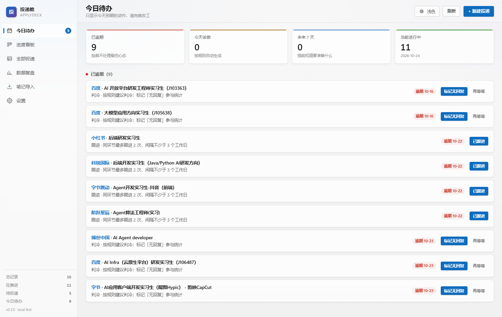
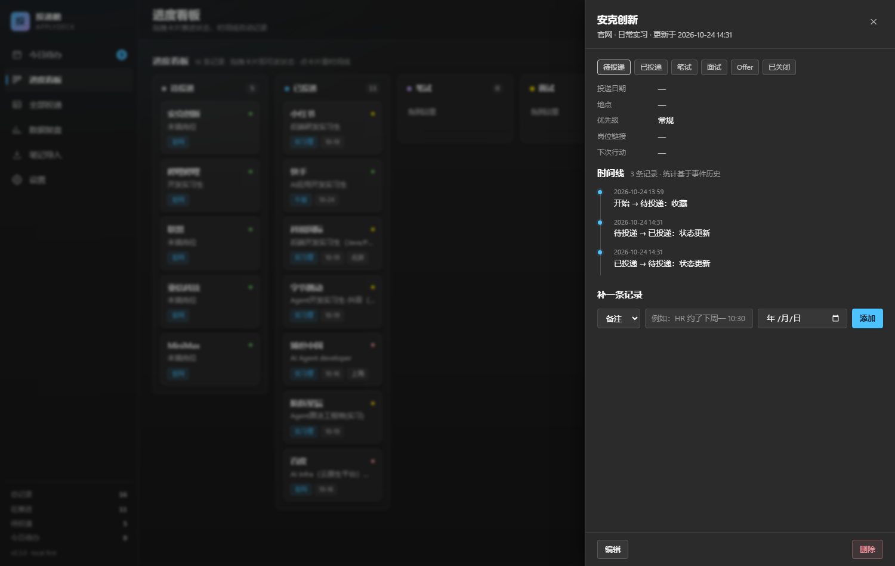
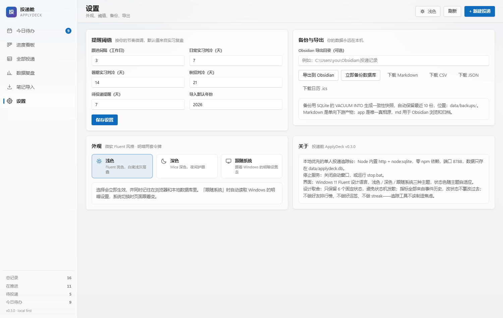
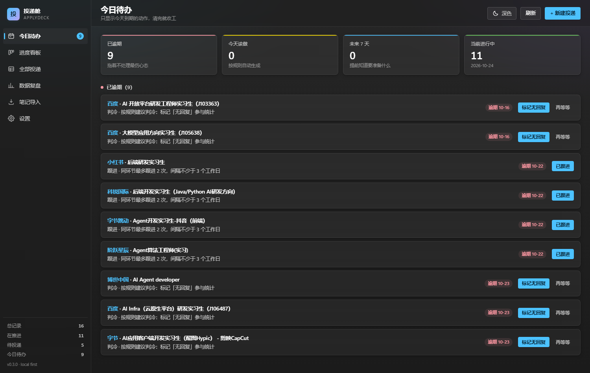

# 投递舱 ApplyDeck

> 本地优先的实习/校招投递追踪台。单进程、零依赖、双击即用；把 Obsidian 笔记一键搬进来，用「今天该干什么」代替「我投了多少家」。
> v0.2.0 起：浏览器一键采集、每天 09:30 桌面提醒、手机局域网访问、日历导出。
> v0.3.0 起：界面换成微软 Fluent / Windows 11 风格，支持浅色 / 深色 / 跟随系统三档主题。



你不需要为了记投递而维护一套云服务。数据就一个 SQLite 文件，卸载 = 删文件夹。

---

## 快速开始

前置：Windows + **Node.js 22.5 或更新**（需要内置 `node:sqlite`，不需要 npm install，不需要编译原生模块）。

1. 双击 **`start.bat`**（或在命令行执行 `node server/index.mjs`）。
2. 浏览器会自动打开 <http://127.0.0.1:8788>。没自动打开就手动访问。
3. 第一次用：左侧「笔记导入」→「加载我的示例笔记」→「解析预览」→「确认导入」。
4. 每天打开只看「今日待办」，清完就关。
5. 右上角主题按钮点一下即可在「浅色 → 深色 → 跟随系统」之间循环；也能在「设置 → 外观」里三选一，选择会记住。

停止：双击 **`stop.bat`**，或直接关掉 start.bat 的窗口。

> 换端口：改 `config.json` 里的 `port`，或 `node server/index.mjs --port 8899`。
>
> 手机/局域网：双击 `start-lan.bat`，窗口会打印 `http://192.168.x.x:8788`，同一 Wi-Fi 下手机直接打开。
> 每日提醒：双击 `install-reminder.bat` 注册 Windows 计划任务（每天 09:30）；`uninstall-reminder.bat` 卸载。

---

## 它解决什么问题

求职笔记的三个真实痛点：**记了不再看、看了不知道该做什么、做了没有反馈**。

所以这个工具只做三件事：

1. **把笔记变成结构化数据**（导入手，不用手抄）。
2. **每天只推当日该做的动作**（跟进/判冷/笔试/面试准备/感谢信/复盘），不做排行榜、不做打卡 streak。
3. **用事件历史算统计**（漏斗、渠道效果、响应速度），改状态不会篡改过去。

### 设计原则（也是取舍）

- **本地优先**：Node 内置 `http` + `node:sqlite`，零 npm 依赖，离线可用，数据不出本机。
- **文件优于应用**：SQLite 是唯一真相源；Markdown 是单向导出产物，给 Obsidian 归档/双链，不双向同步。
- **固定 6 个状态**：待投递 / 已投递 / 笔试 / 面试 / Offer / 已关闭。不允许自定义流程，避免状态爆炸。
- **一切从事件算**：每次改状态写一条 event，统计基于事件历史，而不是"当前快照拍脑袋"。
- **不制造焦虑**：没有连续天数、没有红点轰炸，今日待办为空就大方显示"今天没事了"。

---

## 功能一览

| 模块 | 说明 | 截图 |
| --- | --- | --- |
| 今日待办 | 只列今天/逾期的动作，按规则自动生成；点按钮即闭环 | [today](docs/screenshots/fluent-today-light.png) |
| 进度看板 | 6 列看板，拖拽卡片改状态，自动记录时间线 | [board](docs/screenshots/fluent-board-light.png) |
| 全部投递 | 表格视图，按状态/渠道筛选、按公司岗位搜索、行内编辑删除 | [table](docs/screenshots/fluent-table-light.png) |
| 数据复盘 | 漏斗、渠道效果、响应中位数、每周投递节奏、关闭原因 | [stats](docs/screenshots/fluent-stats-light.png) |
| 笔记导入 | Obsidian md 粘贴 → 规则解析 → 可编辑预览 → 事务提交 → 一键撤销 | [import](docs/screenshots/fluent-import-light.png) |
| 设置 | 提醒阈值可调；导出 md/csv/json/ics；备份数据库；导出到 Obsidian 目录 | — |
| 浏览器采集 | Chrome MV3 扩展：BOSS / 实习僧 / 牛客 职位页一键「加入投递舱」，字段可改后提交 | [popup](extension/docs/popup.png) |
| 每日提醒 | Windows 计划任务每天 09:30 读取「今日待办」，有动作才弹 Toast | — |
| 手机访问 | `start-lan.bat` 局域网模式，手机同 Wi-Fi 打开；已做移动端适配 | [mobile](docs/screenshots/fluent-m-today-light.png) · [dark](docs/screenshots/fluent-m-board-dark.png) |
| 外观主题 | 微软 Fluent 2 / Win11 视觉；浅色 / 深色 / 跟随系统，服务端持久化 | [light](docs/screenshots/fluent-today-light.png) · [dark](docs/screenshots/fluent-today-dark.png) |

详情抽屉（时间线 + 补记录）：





---

## 内置的提醒规则

规则来自实习/校招的常见节奏，全部可在「设置」里改阈值：

- **跟进**：投递后第 3 个工作日（可改）提醒发跟进；同一环节最多跟进 2 次。
- **判冷**：投递后超过阈值无回音，建议标记「无回复」参与统计。日常实习 7 天、暑期 14 天、秋招 21 天。
- **待投递**：收藏超过 7 天还没投，提醒「还投吗」。
- **笔试**：有笔试日期时，提前 1 天提醒准备。
- **面试**：提前 1 天准备；面试后 24 小时内提醒发感谢信；3 个工作日后提醒写 3 行复盘。
- **Offer**：截止前 3 天提醒做决定 / 和 HR 谈延期（7–15 天窗口）。

「今日待办」的每个动作都有明确出口：已跟进 / 标记无回复 / 再等等 / 已投递，避免了"提醒了但没法处理"。

---

## P1 三件套（v0.2.0）

### 1. 浏览器一键采集（Chrome MV3）

1. Chrome 打开 `chrome://extensions`，右上角开启「开发者模式」。
2. 点「加载已解压的扩展程序」，选择本项目的 `extension/` 文件夹。
3. 在 BOSS直聘 / 实习僧 / 牛客 的职位详情页，点工具栏里的「投递舱」图标：会自动填好公司、岗位、地点、薪资、链接，确认后「加入投递舱」。
4. 打开 app 即可看到新记录（状态可选「待投递 / 已投递」，重复的公司+岗位自动去重）。

扩展只读当前页 DOM，用 `activeTab` + `scripting` 按需注入，不登录、不上传任何数据，只请求 `127.0.0.1:8788`。更细的安装说明、支持的站点和选择器限制见 [extension/README.md](extension/README.md)。

### 2. 每日提醒（Windows 计划任务）

- 安装：双击 `install-reminder.bat`，注册计划任务「ApplyDeck Daily Reminder」，每天 09:30 运行 `scripts/remind.mjs`。Toast 仅 Win10/11 有效；Win7/8 会回退成打印 + 写 `data/reminder-last.log`。
- 逻辑：请求本机 `/api/today`；有逾期/今天该做的动作才弹 Windows Toast，没有就静默退出；服务没开也静默退出（不弹错误窗）。
- 手动预览：`node scripts/remind.mjs --dry-run`；想立刻弹一次：`node scripts/remind.mjs`。
- 卸载：双击 `uninstall-reminder.bat`。

### 3. 手机访问与日历

- 手机：双击 `start-lan.bat`，窗口打印 `http://192.168.x.x:8788`，手机连同一 Wi-Fi 直接打开（界面已适配 390px 小屏：看板横向滑动、表格隐藏次要列、抽屉全屏）。首次启动 Windows 防火墙可能弹窗，选「允许」；同一网络内的人也能访问，用完关掉服务。
- 日历：设置页点「下载日历 .ics」，或直接访问 `http://127.0.0.1:8788/api/export/ics?download=1`，把未来的跟进/笔试/面试/Offer 截止导入系统日历。

---

## 外观与主题（v0.3.0）

界面重写为 **微软 Fluent 2 / Windows 11 设计语言**，不是换个深色皮肤，而是两套完整的设计令牌：

- **字体**：Segoe UI Variable（回退 Segoe UI / 系统中文字体），等宽数字用 Cascadia Code。
- **层次**：Mica 质感背景 + 半透明卡片 + `backdrop-filter` 模糊，1px 细边框、8px 圆角、Fluent 按钮的 hover / pressed 层叠态。
- **导航**：Win11 NavigationView 式侧栏，选中项左侧 3px 强调色竖条；窄屏自动折叠成图标条。
- **输入**：Fluent 风格底线聚焦（focus 时底边变强调色 + inset 阴影）。
- **强调色**：浅色主题 `#0f6cbd`，深色主题 `#4cc2ff`（深色下按钮文字自动转深蓝黑保证对比度）。
- **状态色**：待投递 / 已投递 / 笔试 / 面试 / Offer / 已关闭各有独立 token（`--st-*`），两种主题下都保证可读，不再有 JS 里写死的内联颜色。

主题三档：

| 模式 | 行为 |
| --- | --- |
| 浅色 | 始终浅色 |
| 深色 | 始终深色 |
| 跟随系统 | 跟随 Windows「应用模式」，系统切换时页面实时跟随（监听 `prefers-color-scheme`） |

- 切换入口两处：**右上角主题按钮**（单击循环三档）和 **设置 → 外观**（三选一）。
- 记忆方式：前端写 `localStorage`（`applydeck-theme`）保证瞬时生效，同时 PATCH 到服务端 `settings.theme`，换浏览器 / 清缓存后仍保持；多标签页会通过 `storage` 事件同步。
- 首屏防闪白：`index.html` 里有一段内联 pre-paint 脚本，在 CSS 渲染前就把 `data-theme` 写好，深色用户不会先看到一帧白屏。
- 想改配色：只改 `web/style.css` 顶部 `:root`（浅色）和 `html[data-theme="dark"]`（深色）两组变量即可，组件层不出现硬编码颜色。

截图：浅色 / 深色对比（桌面）

| 浅色 | 深色 |
| --- | --- |
|  |  |

---

## 笔记导入规则

把 Obsidian 里这样的内容整段粘进来即可：

```md
**已投递**
百度 大模型应用方向实习生（J105638） 10.9日
**暂未投递**
MiniMax
哔哩哔哩 开发实习生 待投递！
**实习僧**
博世中国 AI Agent developer 上海 10.16日
```

解析器会识别：

- **加粗标题/ Markdown 标题**：已投递、暂未投递、BOSS直聘、实习僧、牛客、内推 → 决定渠道与状态；
- **每行一条**：公司 + 岗位 + 日期 + 城市；
- **公司词典**：百度/字节/Kimi/博世中国/MiniMax/哔哩哔哩…等 40+ 家（不认识的用首词兜底并给提示）；
- **岗位编号**：`J105638` 这类编码并入岗位名；
- **日期**：`10.9`、`10月9日`、`10/9` → 按导入时填的年份补全；
- **城市**：上海/北京/深圳…；
- **纯渠道说明行**（如"直接联系并投递"）会跳过并提示。

导入前会显示**可编辑预览**；已存在的"公司+岗位"会自动标重复并在提交时跳过；每次导入生成一个批次，可一键撤销。

---

## 数据与备份

```
applydeck/
├─ start.bat / stop.bat         # 启停脚本
├─ start-lan.bat                # 局域网模式启动（手机访问）
├─ install-reminder.bat / uninstall-reminder.bat  # 每日提醒注册/卸载
├─ config.json                  # 端口、host、Obsidian 导出目录
├─ server/                      # 后端（Node 内置模块，零依赖）
│  ├─ index.mjs                 # 启动、单实例探测、自动开浏览器
│  ├─ app.mjs                   # HTTP 路由 + 静态服务
│  ├─ db.mjs                    # SQLite schema / 查询
│  ├─ parser.mjs                # 笔记解析
│  ├─ reminders.mjs             # 今日待办规则
│  ├─ stats.mjs                 # 统计
│  ├─ backup.mjs                # VACUUM INTO 备份
│  ├─ lan.mjs                   # 局域网地址探测
│  └─ ics.mjs                   # .ics 日历生成
├─ web/                         # 前端（原生 ES Module，无构建）
│  ├─ index.html                # 含 pre-paint 主题脚本（防闪白）
│  ├─ style.css                 # Fluent 2 令牌：:root 浅色 + [data-theme=dark] 深色
│  └─ js/                       # 路由、视图、组件
│     ├─ theme.js               # 主题解析 / 切换 / 持久化 / 跨标签同步
│     └─ ...                    # api / ui / store / detail / views
├─ extension/                   # Chrome MV3 采集扩展（独立加载，不进 npm）
├─ scripts/                     # remind.mjs 每日提醒 / import-seed.mjs 导入示例
├─ seeds/my-note.md             # 示例笔记
├─ tests/                       # node:test 单测 + e2e 脚本
└─ data/                        # 运行时数据（gitignore）
   ├─ applydeck.db              # 唯一真相源
   └─ backups/                  # 自动保留最近 10 份
```

- **备份**：设置页「立即备份数据库」→ `data/backups/applydeck-*.db`，用 `VACUUM INTO` 生成一致性快照（直接复制 .db 在 WAL 模式下可能损坏，所以别用复制）。
- **导出**：Markdown（按状态分组 + 时间线）、CSV（中文表头，带 BOM，Excel 直接开）、JSON（完整备份）。
- **Obsidian**：设置里填你的 vault 目录（如 `C:\\Users\\you\\Documents\\Obsidian\\投递记录`），点「导出到 Obsidian」会写一份 `ApplyDeck-YYYY-MM-DD.md`。

---

## 开发与测试

```bash
node server/index.mjs --no-open      # 不自动开浏览器
npm test                              # node:test 单测（解析 + API）
node tests/e2e.mjs                    # 端到端：起真实服务、导入、拖拽改状态、导出、撤销
node tests/smoke.mjs                  # 解析/规则的人工可读快照
node extension/verify.mjs             # 采集扩展：4 个站点 fixture 解析 + popup 截图
node scripts/remind.mjs --dry-run     # 预览每日提醒文案（不弹窗）
node scripts/theme-check.mjs          # 主题行为验收：持久化 / 循环切换 / 跨标签同步
node scripts/cdp-shot.mjs <url> <out.png> 1500 950 1 dark  # 指定主题截图（需服务在 8788）
```

技术栈是有意"无聊"的：Node 内置 `http` + `node:sqlite` + 原生 ES Module 前端。没有 React、没有打包器、没有 ORM —— 三年后你还能直接打开改。

---

## Roadmap

**已落地（v0.3.0）**

- ✅ 微软 Fluent 2 / Windows 11 视觉重写（Mica 背景、半透明卡片、Fluent 按钮与输入框、NavigationView 侧栏）。
- ✅ 浅色 / 深色 / 跟随系统三档主题：右上角一键循环 + 设置页选择，服务端持久化、跨标签同步、首屏无闪白。
- ✅ 状态与严重度颜色全部走 CSS 令牌，两种主题下自动适配（不再有 JS 内联颜色）。

**已落地（v0.2.0）**

- ✅ Chrome MV3 扩展：BOSS / 实习僧 / 牛客 职位页一键「加入投递舱」，自动抓公司/岗位/地点/薪资/链接，字段可改后提交。
- ✅ Windows 计划任务每日 09:30 提醒（有动作才弹，无动作静默）。
- ✅ 局域网/手机访问（`start-lan.bat`，已做移动端适配；未做二维码）。
- ✅ `.ics` 日历导出（跟进/判冷/待投递动作进日历）。

**P2（想清楚再做）**

- 按钮触发的 AI 辅助：JD 提炼、复盘生成、跟进话术（DeepSeek API，必须显式点击，不做自动调用）。
- 把「投递复盘」做成可复用的 agent skill，让 AI 读事件历史给建议。
- 多设备同步（目前刻意不做：本地单机足够，云端是负担）。

**明确不做**：自动投递、爬登录态网站、云端账户体系、邮箱自动解析、Electron 打包、打卡排行。

---

## 已知限制

- 需要 Node.js ≥ 22.5（内置 `node:sqlite`）。更老的 Node 会直接报错。
- 目前是单机单用户；没有登录、没有并发控制。
- 移动端已适配到 390px 小屏（看板横滑、表格隐藏次要列、抽屉全屏），但下拉刷新/手势操作没有做。
- 看板拖拽依赖鼠标/触控板；触屏浏览器不支持 HTML5 拖拽（可用详情抽屉里点状态按钮替代）。
- 所有时间按本机时区处理。
