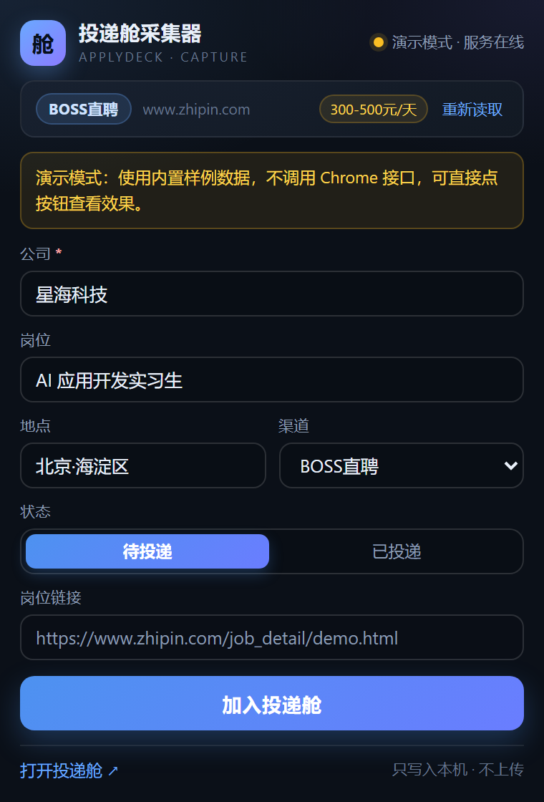

# 投递舱采集器 · ApplyDeck Capture

ApplyDeck（投递舱）的 Chrome 扩展（MV3）：在 **BOSS直聘 / 实习僧 / 牛客** 的职位详情页一键把当前 JD 采集进本机投递舱，免去复制粘贴。

纯本地、零 npm 依赖：扩展只读取当前页 DOM，只把数据 POST 到 `http://127.0.0.1:8788/api/capture`，不收集、不上传、不联网。



## 功能

- 打开弹窗自动识别当前职位页，提取 **公司 / 岗位 / 地点 / 薪资 / 渠道 / 链接**；
- 深色 Fluent 弹窗内可编辑预览，渠道可选 6 种（官网 / BOSS直聘 / 实习僧 / 牛客 / 内推 / 其他），状态默认「待投递」；
- 点「加入投递舱」写入本机投递舱：新记录显示绿色「已加入」，重复记录显示琥珀色「已存在，已为你定位」；
- 顶部实时显示本机服务状态（在线绿点 / 离线红点并提示先双击 `start.bat`）；
- 提取失败或页面不可注入（`chrome://`、扩展页、新标签页等）时给出友好提示，仍可手动填写提交。

## 安装

1. 先把 ApplyDeck 跑起来：双击项目根目录的 `start.bat`（服务地址 http://127.0.0.1:8788）。
2. Chrome 地址栏打开 `chrome://extensions`。
3. 右上角打开 **开发者模式**。
4. 点 **加载已解压的扩展程序**，选择本目录：`F:\vibe-coding\applydeck\extension`。
5. 建议把「投递舱采集器」固定到工具栏（拼图图标 → 图钉）。

## 使用

1. 打开 BOSS直聘 / 实习僧 / 牛客 的职位详情页；
2. 点击工具栏上的扩展图标；
3. 确认弹窗里的公司、岗位、地点、渠道、状态（默认「待投递」）；
4. 点 **加入投递舱**，完成后点 **打开投递舱 ↗**（http://127.0.0.1:8788/#/table）查看记录。

## 支持站点与识别方式

| 站点 | 域名 | 渠道值 | 主要选择器 | 兜底 |
| --- | --- | --- | --- | --- |
| BOSS直聘 | `zhipin.com` | `boss` | `.job-banner .job-name`、`.salary`、`.job-address`、`.company-info .company-name` | 解析 `document.title`（如「岗位_公司_地点-薪资-BOSS直聘」） |
| 实习僧 | `shixiseng.com` | `shixiseng` | `.new_job_name`、`.com-name`、`.job_msg` | 解析标题（含 `【城市】` 前缀） |
| 牛客 | `nowcoder.com` | `nowcoder` | `.job-detail-header .job-name`、`.company-name`、`.job-city`、`.job-salary` | 解析标题 |
| 其他站点 | 任意 http(s) | `official` | — | `og:title` / `document.title` 拆分 |

本地 `fixtures/` 下的 4 个静态页模拟了以上结构，供 `verify.mjs` 回归使用。

## 数据契约

扩展提交到 `POST http://127.0.0.1:8788/api/capture`：

```
POST /api/capture
Content-Type: application/json

{
  "company": "星海科技",            // 必填
  "role": "AI 应用开发实习生",
  "channel": "boss",              // official | boss | shixiseng | nowcoder | referral | other
  "status": "wishlist",           // wishlist（待投递，默认）| applied（已投递）
  "url": "https://...",           // 仅当能取到链接时提交
  "location": "北京",
  "salary": "300-500元/天"
}
```

响应：

- `201 { ok: true, duplicated: false, app: {...} }` → 已新增，弹窗显示绿色结果卡；
- `200 { ok: true, duplicated: true, app: {...} }` → 已存在，弹窗显示琥珀色「已存在，已为你定位」；
- `400 { error: "..." }` → 参数不合法，弹窗显示红色错误与「重试」；
- 连接失败 → 说明本机服务没启动，提示先双击 `start.bat`。

健康检查：`GET http://127.0.0.1:8788/api/health`。

## 隐私说明

- **只读当前页 DOM**：仅在点击扩展图标时通过 `chrome.scripting.executeScript` 在当前标签页执行一次 `extractJob()`，读取公司、岗位、地点、薪资与链接；不修改页面、不读取登录信息、不读取其他标签页。
- **只写本机**：唯一的外发请求是 POST 到 `127.0.0.1:8788`（以及健康检查 GET），不会访问任何第三方服务器。
- **不收集、不上传**：无统计、无埋点、无远程配置；扩展没有 background service worker，不常驻运行。
- **权限最小化**：`activeTab`（点击图标后临时访问当前标签页，配合 `scripting` 注入提取函数）；host_permissions 仅 `127.0.0.1:8788` 与 `localhost:8788`。

## 已知限制

- 招聘站点改版后，选择器可能失效，需要更新 `extract.js` 里的选择器列表；此时标题兜底仍可能拿到部分字段。
- 页面内容由前端异步渲染时，若职位详情尚未加载完就点开弹窗，可能读不到字段；等页面加载完点「重新读取」即可。
- 登录墙 / 验证码 / 职位列表页无法采集，只支持详情页。
- 若职位详情在 iframe 中，读取不到（当前只注入顶层页面）。
- 不支持 `chrome://`、扩展页、新标签页、本地文件页等受限页面。
- 同一公司 + 岗位重复采集不会创建新记录（服务端去重），只会定位到已有记录。

## 验证脚本

零依赖 Node 脚本，启动临时静态服务器 + 本机 Chrome headless，通过 CDP 在 4 个 fixture 里注入 `extract.js` 并断言提取结果，最后顺带生成弹窗截图：

```bash
# 在项目根目录 F:\vibe-coding\applydeck 下运行
node extension/verify.mjs
```

期望输出：

```
EXT VERIFY: 4 passed, 0 failed
```

- 同时生成 `docs/popup.png`（弹窗预览）与 `docs/popup-result.png`（演示模式结果卡）；
- 找不到 Chrome 时打印 SKIP 并 exit 0；
- 脚本会自动清理临时 `user-data-dir`、headless Chrome 与静态服务器。

## 演示模式（无需安装）

直接用浏览器打开 `extension/popup.html?demo=1`（或任意带 `demo=1` 的地址），弹窗会使用内置样例数据渲染预览，不调用 Chrome 扩展接口，便于截图与走查。弹窗截图就是用它生成的。

## 目录结构

```
extension/
├── manifest.json        # MV3 清单
├── extract.js           # 页面上下文提取（classic script，全局 extractJob）
├── popup.html           # 弹窗结构
├── popup.css            # 深色 Fluent 样式
├── popup.js             # 服务检测 / 注入 / 预览 / 提交
├── verify.mjs           # 零依赖端到端验证（headless Chrome + CDP）
├── fixtures/            # 4 个模拟职位页（boss / shixiseng / nowcoder / generic）
└── docs/                # verify 生成的弹窗截图
```
